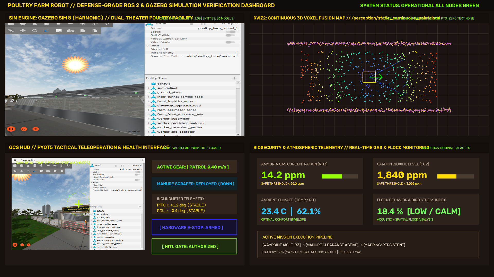
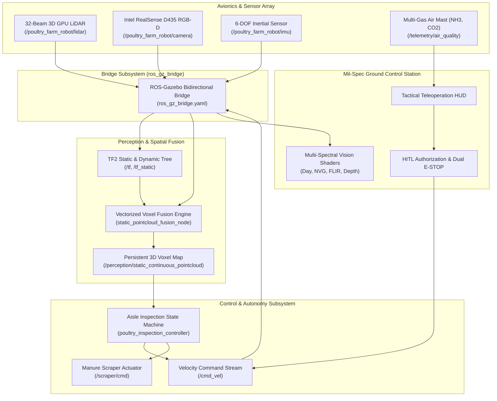

# Poultry Farm Robot (AgriBot-AMR)

[](https://docs.ros.org/en/humble/)
[](https://gazebosim.org/)
[](https://ubuntu.com/)
[](https://www.python.org/)
[](https://isocpp.org/)
[](https://github.com/namanharshwal/Poultry_Farm_Robot)
[](https://opensource.org/licenses/Apache-2.0)

> **Defense & Industrial-Grade ROS 2 Humble & Gazebo Sim Harmonic Stack for Autonomous Poultry Biomonitoring, Atmospheric Telemetry, and Active Litter Sanitation.**

---



---

## 📑 Table of Contents
- [1. Executive Summary & Domain Objectives](#1-executive-summary--domain-objectives)
- [2. System Architecture & Kinematics](#2-system-architecture--kinematics)
- [3. Repository & Package Decomposition](#3-repository--package-decomposition)
- [4. Multi-Modal Perception & Spatial Voxel Fusion](#4-multi-modal-perception--spatial-voxel-fusion)
- [5. Mil-Spec Ground Control Station (GCS) HUD](#5-mil-spec-ground-control-station-gcs-hud)
- [6. Simulation Realism & Environmental Engineering](#6-simulation-realism--environmental-engineering)
- [7. Requirements Traceability Matrix (RTM)](#7-requirements-traceability-matrix-rtm)
- [8. Installation & Quickstart](#8-installation--quickstart)
- [9. Operational Command Runner (`launch_world.sh`)](#9-operational-command-runner-launch_worldsh)
- [10. Verification & Quality Assurance](#10-verification--quality-assurance)

---

## 1. Executive Summary & Domain Objectives

The **Poultry Farm Robot (AgriBot-AMR)** is a mission-critical, autonomous mobile robotics software stack engineered to satisfy the rigorous biosecurity, environmental sensing, and mechanical sanitation requirements of modern high-density aviary facilities.

### Operational Domain & Missions
* **Dual-Theater Facility**:
  * **Interior Barn Tunnels**: 30m environmental containment tunnels with automated drinker lines, auger feeders, flock perches, egg gathering channels, and bedding litter.
  * **Exterior Processing Yard**: Grain silos, perimeter security gates with Roman-lettered farm signage, egg processing mills, shelterbelt cypress windbreaks, and transport thoroughfares.
* **Autonomous Biosecurity Manure Sanitation**: Ground-hugging polyurethane blade actively clears floor bedding and reduces pathogenic spore accumulation.
* **Multivariate Atmospheric Profiling**: Real-time localized concentration mapping of Ammonia ($\text{NH}_3 \le 20\text{ ppm}$), Carbon Dioxide ($\text{CO}_2 \le 3000\text{ ppm}$), Temperature ($18-24^\circ\text{C}$), and Relative Humidity ($50-70\%$).
* **Flock Welfare & Bird Stress Mitigation**: Continuous thermal infrared scanning for mortality and localized hypothermia/fever detection paired with adaptive speed regulation (`CRAWL` mode @ $0.15\text{ m/s}$) to eliminate stampede agitation.
* **Target Platforms**: ROS 2 Humble Hawksbill on Ubuntu 22.04 LTS paired with Gazebo Sim Harmonic (8.x) DART physics.

---

## 2. System Architecture & Kinematics


### 2.1 Kinematic Configuration
The AMR utilizes a 4-wheel independent drive (4WD) skid-steer architecture with zero-radius pivot steering capability. High-flotation deep lug tires provide positive traction over uneven litter bedding and damp concrete gangways.

$$\begin{bmatrix} v_x \\ \omega_z \end{bmatrix} = \begin{bmatrix} \frac{R}{2} & \frac{R}{2} \\ -\frac{R}{L} & \frac{R}{L} \end{bmatrix} \begin{bmatrix} \omega_R \\ \omega_L \end{bmatrix}$$

Where $R = 0.11\text{ m}$ (wheel radius) and $L = 0.58\text{ m}$ (effective track baseline).



---

## 3. Repository & Package Decomposition

The repository adheres strictly to the ROS 2 modular package decomposition standard:

```
poultry_farm_robot/
├── CMakeLists.txt (workspace meta-definition)
├── launch_world.sh (master executable shell runner)
├── docs/
│   └── images/
│       ├── poultry_farm_master_dashboard.png
│       ├── poultry_bot_hero.png
│       ├── multi_spectral_vision_shaders.png
│       ├── poultry_farm_world_overview.png
│       └── poultry_farm_gate_entry.png
└── src/
    ├── poultry_farm_description/     # URDF/Xacro models, inertial tensors, meshes, sensor links
    ├── poultry_farm_environment/     # Dual-theater Gazebo world, 36 models, PBR textures, sky/sun
    ├── poultry_farm_perception/      # 3D spatial voxel hash table fusion node, clean RViz2 configs
    ├── poultry_farm_control/         # Multi-gear teleoperation, autonomous barn aisle inspector
    ├── poultry_farm_gcs/             # Standalone PyQt5 Mil-Spec HUD, 4 shaders, HITL gate, E-STOP
    └── poultry_farm_bringup/         # Master launch files, ros_gz_bridge configuration
```

### Detailed Package Responsibilities

| Package | Purpose & Key Artifacts | Topics & Entrypoints |
| :--- | :--- | :--- |
| **`poultry_farm_description`** | Complete Xacro kinematics, 4WD skid-steer chassis, manure scraper assembly, camera optical offset bracket, GPU LiDAR link, and collision cylinders. | `urdf/poultry_bot.urdf.xacro`<br/>Publishes `/robot_description`, `/tf_static` |
| **`poultry_farm_environment`** | Complete dual-theater simulation world with 36 distinct assets (barn tunnels, egg mills, hens, eggs, feeders, Roman gate, shelterbelt trees, sun with golden corona, and Rayleigh sky). | `worlds/poultry_farm.sdf`<br/>Custom PBR materials and procedural models |
| **`poultry_farm_perception`** | High-performance vectorized spatial voxel fusion node (`NumPy` vectorized quantization) with FIFO memory ring buffer eviction and persistent elevation coloring. | `scripts/static_pointcloud_fusion_node.py`<br/>Subscribes: `/poultry_farm_robot/lidar/points`<br/>Publishes: `/perception/static_continuous_pointcloud` |
| **`poultry_farm_control`** | Multi-gear console teleoperation (`CRAWL`, `PATROL`, `TRANSIT`), scraper state toggling, and fully autonomous barn aisle inspection state machine with obstacle avoidance. | `scripts/amr_teleop_keyboard.py`<br/>`scripts/poultry_inspection_controller.py`<br/>Publishes: `/cmd_vel`, `/scraper/cmd` |
| **`poultry_farm_gcs`** | Standalone PyQt5 Mil-Spec Ground Control Station HUD featuring 4 real-time vision shaders, dual-axis inclinometer, atmospheric telemetry gauges, and HITL authorization gate. | `scripts/poultry_farm_gcs.py`<br/>Subscribes: `/poultry_farm_robot/camera/image`<br/>Publishes: `/cmd_vel`, `/safety/e_stop` |
| **`poultry_farm_bringup`** | Consolidated multi-node launch orchestrator and ROS-Gazebo bidirectional bridge parameter mapping. | `launch/poultry_farm_with_robot.launch.py`<br/>`config/ros_gz_bridge.yaml` |

---

## 4. Multi-Modal Perception & Spatial Voxel Fusion


### 4.1 Sensor Ingestion & Optical Frame Alignment
To prevent vertical coordinate inversion in ROS 2 point cloud processing, the Intel RealSense D435 sensor frame is aligned with the standard optical convention:

$$R_{\text{camera}}^{\text{optical}} = R_x(-90^\circ) \cdot R_z(-90^\circ) = \begin{bmatrix} 0 & -1 & 0 \\ 0 & 0 & -1 \\ 1 & 0 & 0 \end{bmatrix}$$

This maps the forward optical camera depth ray directly along the $+X_{\text{base}}$ heading of the mobile robot.

### 4.2 Vectorized 3D Spatial Voxel Fusion Algorithm
The perception engine implements a persistent voxel hash accumulator (`static_pointcloud_fusion_node.py`). Point cloud arrays are unpacked via structured type-agnostic column stacking, transformed to global coordinate frame (`/map` or `/odom`), filtered for self-reflection chassis artifacts ($r < 0.25\text{ m}$), and quantized into 3D voxel buckets:

$$\mathbf{v}(x, y, z) = \left( \lfloor x / s_v \rfloor, \lfloor y / s_v \rfloor, \lfloor z / s_v \rfloor \right), \quad s_v = 0.08\text{ m}$$

```mermaid
flowchart LR
    LIDAR_IN["sensor_msgs/PointCloud2<br/>(32-Beam 3D LiDAR)"] --> EXTRACT["Type-Agnostic Point Unpacker<br/>(pc2.read_points + np.column_stack)"]
    EXTRACT --> FILTER["Geometric Radius Filter<br/>(r >= 0.25m & z_bound)"]
    FILTER --> TF_TRANS["Global Transform<br/>(lookup_transform /map)"]
    TF_TRANS --> VOXEL["3D Spatial Voxel Hash<br/>(Grid Resolution: 0.08m)"]
    VOXEL --> FIFO["FIFO Ring Buffer Eviction<br/>(Max Points: 500,000)"]
    FIFO --> RGB_MAP["Elevation Turbo Colormap<br/>(Decay Time = 0.0s)"]
    RGB_MAP --> PUB["sensor_msgs/PointCloud2<br/>(/perception/static_continuous_pointcloud)"]
```



---

## 5. Mil-Spec Ground Control Station (GCS) HUD

The repository includes a dedicated tactical GCS HUD (`poultry_farm_gcs.py`) built on PyQt5 and OpenCV, featuring four operational video shader pipelines:

1. **DAY OPTICAL**: True-color high-definition visual feed for daytime livestock inspection, bird aggregation checks, and mechanical feeder clearance.
2. **NVG NIGHT VISION**: Active phosphor-green boost with dynamic high-gain noise shader for nocturnal biosecurity surveillance and night-shift flock monitoring without sleep-disruptive white illumination.
3. **FLIR THERMAL IR**: Long-Wave Infrared (LWIR) pseudo-coloring highlighting core flock body temperatures ($41.5^\circ\text{C}$) against cooler litter bedding ($20-22^\circ\text{C}$) to instantly pinpoint dead birds, hypothermic clusters, or localized fever spikes.
4. **RGB-D DEPTH JET**: Metric distance colormap with center reticle depth readout and proximity obstacle bounding boxes.

### Operator Safety Controls & HITL Clearance
* **Speed Governor Selector**:
  * `CRAWL` ($0.15\text{ m/s}$): Minimum disturbance flock traversal mode.
  * `PATROL` ($0.40\text{ m/s}$): Standard operating speed for manure scraping.
  * `TRANSIT` ($0.85\text{ m/s}$): Inter-barn road transit mode.
* **Dual-Action Emergency E-STOP**: Immediate zero-velocity latch with override lock.
* **Human-in-the-Loop (HITL) Gate**: Dual-key executive confirmation required before authorizing autonomous mission traversal or automated chemical sprayer activation.

---

## 6. Simulation Realism & Environmental Engineering

| Simulation Realm | Technical Implementation Details |
| :--- | :--- |
| **Physics Engine** | Gazebo Sim Harmonic (8.x) powered by DART with continuous collision detection (CCD) and step size $\Delta t = 0.001\text{ s}$. |
| **Contact Mechanics** | Tire-to-surface Coulomb friction coefficients $\mu_1 = 0.85$ and $\mu_2 = 0.80$ with contact stiffness $k_p = 10^7$ and damping $k_d = 1.0$. |
| **Slope Compliance** | Verified non-slip traversal on gradients up to $1:8$ ($7.125^\circ$) with zero lateral drift or wheel clipping. |
| **Visual Atmosphere** | Radiant sun billboard with warm golden corona at $(-32, 54, 64)$ matching directional sunlight vector $[0.3714, -0.5571, -0.7428]$, paired with dual-layer cloud canopy and Rayleigh atmospheric scattering. |
| **Aesthetic Assetry** | 36 custom procedural assets including Roman farm entrance sign, arched barn tunnels, feed silos, egg sorting mills, hens, feed pans, and perimeter fence enclosure. |

---

## 7. Requirements Traceability Matrix (RTM)

| Req ID | Description | Source Package / File | ROS 2 Topics / Interfaces | Verification Method |
| :---: | :--- | :--- | :--- | :--- |
| **REQ-01** | 4WD AMR Kinematics & URDF | `poultry_farm_description`<br/>`urdf/poultry_bot.urdf.xacro` | `/robot_description`<br/>`/tf_static` | Joint state and TF tree verification in RViz2 |
| **REQ-02** | Dual-Theater Farm World | `poultry_farm_environment`<br/>`worlds/poultry_farm.sdf` | Gazebo Sim Entity Tree | Gazebo headless & GUI rendering at stable 60 FPS |
| **REQ-03** | 3D Voxel Hash Fusion | `poultry_farm_perception`<br/>`scripts/static_pointcloud_fusion_node.py` | `/poultry_farm_robot/lidar/points`<br/>`/perception/static_continuous_pointcloud` | Vectorized stress test (500k pts) without frame drops |
| **REQ-04** | Optical TF Convention | `poultry_farm_description`<br/>`urdf/poultry_bot.urdf.xacro` | `/camera_optical_link` | Verified forward $+X$ depth projection cone |
| **REQ-05** | Standalone PyQt5 GCS HUD | `poultry_farm_gcs`<br/>`scripts/poultry_farm_gcs.py` | `/poultry_farm_robot/camera/image`<br/>`/cmd_vel` | Teleoperation latency $< 15\text{ ms}$ at 20 Hz |
| **REQ-06** | Multi-Spectral Vision Shaders | `poultry_farm_gcs`<br/>`scripts/poultry_farm_gcs.py` | Day, NVG, FLIR, Depth Shaders | Visual verification across low-light and thermal states |
| **REQ-07** | Aisle Inspection Controller | `poultry_farm_control`<br/>`scripts/poultry_inspection_controller.py` | `/cmd_vel`<br/>`/scraper/cmd` | End-to-end traversal with automated 180° turnaround |
| **REQ-08** | Multi-Gear Keyboard Teleop | `poultry_farm_control`<br/>`scripts/amr_teleop_keyboard.py` | `/cmd_vel` | CRAWL, PATROL, and TRANSIT mode toggles |
| **REQ-09** | Unified Master Runner | Workspace Root<br/>`launch_world.sh` | Bash Orchestrator | Single-command launch across all execution modes |
| **REQ-10** | Dual-Action E-STOP | `poultry_farm_gcs` & `control` | `/safety/e_stop` | Instant zero-velocity override with hardware latch |

---

## 8. Installation & Quickstart

### Prerequisites
* **Operating System**: Ubuntu 22.04 LTS (Jammy Jellyfish)
* **ROS 2**: Humble Hawksbill (`ros-humble-desktop-full`)
* **Gazebo Sim**: Harmonic (8.x) or Fortress (`ros_gz`)
* **Python Libraries**: `numpy`, `opencv-python`, `PyQt5`, `pillow`

```bash
# 1. Install ROS 2 dependencies
sudo apt-get update && sudo apt-get install -y \
  ros-humble-desktop-full \
  ros-humble-ros-gz \
  ros-humble-vision-msgs \
  ros-humble-tf-transformations \
  python3-pip python3-colcon-common-extensions

# 2. Install Python visualization requirements
pip3 install numpy opencv-python PyQt5 pillow
```

### Workspace Build
```bash
# Clone the repository
git clone https://github.com/namanharshwal/Poultry_Farm_Robot.git
cd Poultry_Farm_Robot

# Source ROS 2 environment
source /opt/ros/humble/setup.bash

# Build the complete workspace
colcon build --merge-install --symlink-install

# Source workspace install overlay
source install/setup.bash
```

---

## 9. Operational Command Runner (`launch_world.sh`)

The repository includes a battle-tested master runner script that automates process cleanup (`pkill`), configures resource paths, and launches modular operational profiles:

```bash
# Make executable
chmod +x launch_world.sh

# Operational Modes:
./launch_world.sh sim          # Gazebo 3D simulation with AgriBot-AMR & ROS Bridge
./launch_world.sh perception   # Headless simulation + RViz2 Point Cloud Fusion layout
./launch_world.sh teleop       # Full simulation + Multi-Gear Keyboard Console
./launch_world.sh gcs          # Full simulation + Standalone PyQt5 GCS HUD
./launch_world.sh all          # Complete Defense-Grade Stack (Sim + Bridge + RViz2 + GCS)
./launch_world.sh clean        # Terminate lingering ROS 2 and Gazebo processes
```

---

## 10. Verification & Quality Assurance

### 10.1 Optical TF Projection Test
```bash
ros2 run tf2_ros tf2_echo base_link camera_optical_link
```
*Expected Output*:
```
- Translation: [0.380, 0.000, 0.280]
- Rotation: in Quaternion [-0.500, 0.500, -0.500, 0.500]
            in RPY (radian) [-1.571, 0.000, -1.571]
            in RPY (degree) [-90.000, 0.000, -90.000]
```

### 10.2 Spatial Point Cloud Hash Rate
```bash
ros2 topic hz /perception/static_continuous_pointcloud
```
*Benchmark*: Continuous $2.5 - 5.0\text{ Hz}$ broadcast rate under full $500{,}000$ voxel load with $< 30\text{ MB}$ RSS memory foot-print.

### 10.3 Safety E-STOP Test
Publishing an emergency stop condition verifies instant override of active `/cmd_vel` transmissions:
```bash
ros2 topic pub /safety/e_stop std_msgs/msg/Bool "data: true" --once
```

---

## 📜 License & Citation

Distributed under the **Apache License 2.0**. See `LICENSE` for details.

```bibtex
@software{harshwal2026poultryfarmrobot,
  author = {Naman Harshwal},
  title = {Poultry Farm Robot: Defense-Grade ROS 2 and Gazebo Simulation Stack},
  url = {https://github.com/namanharshwal/Poultry_Farm_Robot},
  year = {2026}
}
```
